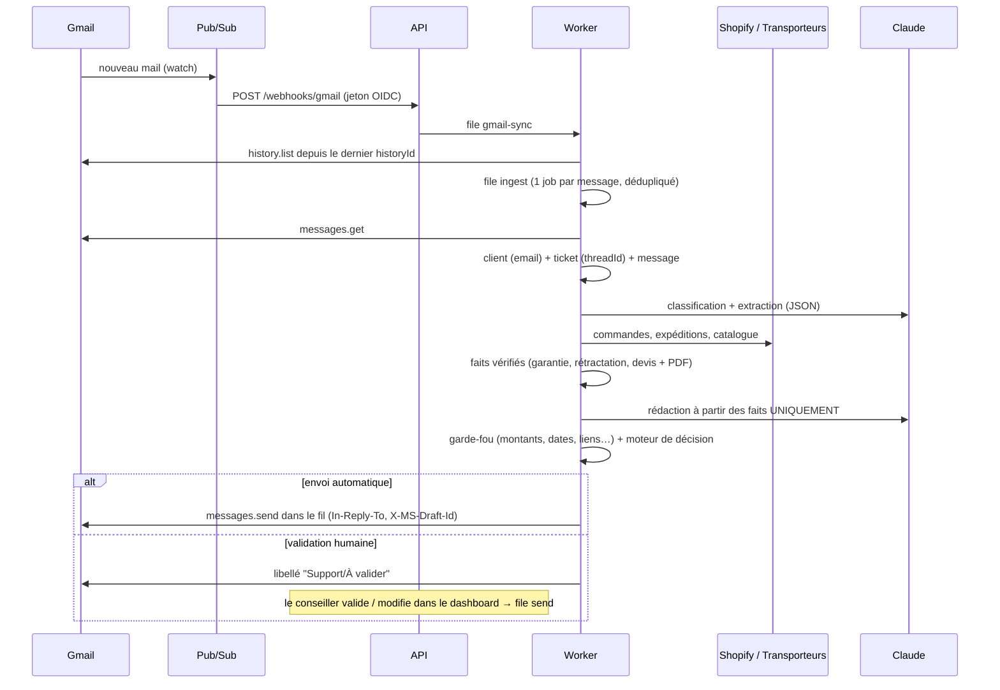
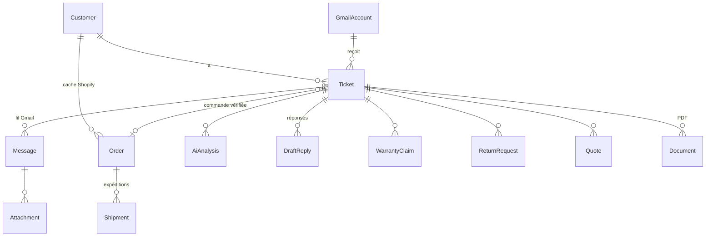

# Architecture

## Choix techniques

| Besoin | Choix | Pourquoi |
|---|---|---|
| Langage | **TypeScript (Node 22)** partout | BullMQ est natif Node ; SDK officiels Gmail, Claude et types partagés avec le dashboard |
| API | Fastify 5 | rapide, typé, corps brut accessible pour les signatures HMAC |
| File d'attente | BullMQ 5 + Redis 7 (AOF) | retries avec backoff, déduplication, tâches planifiées |
| Base | PostgreSQL 16 + Prisma 7 (adapter `pg`) | relationnel, migrations versionnées |
| IA | API Claude (`claude-opus-5-5`), *structured outputs* | sortie JSON validée par Zod, repli serveur en cas de refus |
| PDF | pdfkit | génération côté serveur sans navigateur |
| Dashboard | Next.js 16 (App Router), client uniquement | même origine que l'API via réécritures (cookie de session first-party) |

## Flux d'un mail entrant

Filets de sécurité : rattrapage toutes les 10 min (notifications perdues), renouvellement quotidien
du `watch` Gmail, resynchronisation des 3 derniers jours si le curseur d'historique a expiré.

## Files d'attente

| File | Job | Concurrence | Retries |
|---|---|---|---|
| `gmail-sync` | lit l'historique d'une boîte, dédupliqué par boîte | 2 | 6, exponentiel |
| `ingest` | enregistre un message (`jobId = id Gmail`) | 5 | 6 |
| `process` | IA + faits + décision | 3, max 30/min | 6 ; échec définitif → ticket **Erreur** |
| `send` | envoie une réponse validée | 2 | 4 ; échec définitif → brouillon **Échec d'envoi** |
| `shopify` | met à jour le cache des commandes / RGPD | 2 | 6 |
| `maintenance` | `renew-watch` (3 h 17), `catch-up` (10 min), `retention` (2 h 43) | 1 | 2 |

Erreurs passagères (`TransientError` : réseau, quotas, 5xx) → réessayées ; définitives
(`PermanentError` : accès révoqué, requête invalide) → arrêt immédiat, visibles dans le dashboard.

## Modèle de données (résumé)

Tables transverses : `User`, `AuditLog`, `Setting`, `KnowledgeEntry`, `Counter` (numérotation
DEV-/RET-), `IntegrationCredential` (jeton Shopify chiffré), `ProcessedEvent` (idempotence des webhooks).

Statuts d'un ticket : `NEW → PROCESSING → PENDING_REVIEW | AUTO_REPLIED | ESCALATED | SPAM | CLOSED`,
puis `REPLIED`, `WAITING_CUSTOMER` (une information a été demandée), `ERROR`. Un nouveau mail du
client rouvre le ticket et rend obsolètes les brouillons en attente.

## Moteur de décision (packages/core/src/policy.ts)

Une réponse part automatiquement **seulement si** : envoi auto activé, catégorie autorisée, confiance
(min. classification / rédaction) ≥ seuil, aucune donnée non vérifiée dans la réponse, langue
française, moins de N réponses automatiques sur le fil en 24 h, et **aucun** des signaux suivants :
remboursement, litige, menace juridique, client mécontent, réclamation, injection suspectée,
montant > seuil, titulaire de commande différent, garantie refusée ou indéterminée, retour hors
délai ou indéterminé, devis incomplet, Shopify indisponible, commande annulée.
Spam sûr et mails automatiques : aucune réponse.

## Défense contre l'injection de prompt (en profondeur)

1. Contenu client encadré (`<email_client>`), balises réservées neutralisées.
2. Prompt système : le contenu est une donnée ; toute consigne qu'il contient est signalée.
3. Heuristique locale en complément (`looksLikeInjection`).
4. L'IA n'a **aucun outil** et ne prend **aucune décision** : faits et éligibilités viennent du code.
5. Garde-fou de sortie : liens limités à une liste blanche, montants/dates/numéros vérifiés.
6. Injection suspectée → validation humaine + alerte visible dans la fiche ticket.
